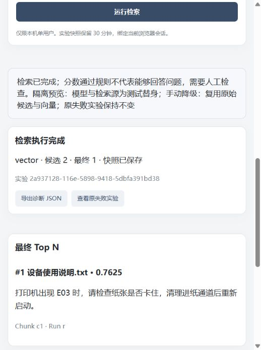

# A2 在线检索实验

实现依据：`C:/javapractice/Job/output/study/05_A2在线检索实验模块实现规格.md`。
入口：顶部导航 **检索实验**。用于开发者检查召回、评分和筛选；不接回答生成模型。

## 使用

1. 按项目原有方式启动依赖与应用，使用 `http://127.0.0.1:8000` 或 `http://localhost:8000` 直接访问。
2. 知识库需要至少一个完整发布的 `active_run_id`。选知识库，也可以限定文档。
3. 填写 query、Top K、Top N、阈值和模型权重，运行检索。
4. 检查最终结果与全部候选。失败、未评分、低于阈值、超出 Top N 会分别标记。
5. Rerank 失败时可以手动复用原候选降级。导出 JSON 可以保存诊断；导出无向量、无连接密钥。

新增模型配置时可以选择 **Rerank（/rerank 协议）**，填写 Base URL、Key 和模型名。
适配器请求 `Base URL + /rerank`，需要返回完整 `results: [{index, relevance_score}]`，分数为有限的 `[0,1]` 数值。
暂不支持返回任意 logits 的供应商；不擅自套 sigmoid。连接测试也调用 rerank，不调用 chat。
模型名复用已有 `model_configurations.chat_model` 存储列；页面明确标为 Rerank，不新增数据库字段。

## 链路与评分

```text
本机访问检查 → 参数校验 → 固定 KB / 文档 / active_run 范围
  → 原问题 embedding + 关键词分词
  → 一次 ES query + knn 混合召回（总返回量 <= Top K）
  → 候选标题 / 正文覆盖率 + cosine 或 rerank
  → 加权融合 → final_score >= threshold → 稳定排序取 Top N
```

- 初次 ES 固定 keyword boost=0.05、vector boost=0.95；用户模型权重不改变这一步。
- ES 两路带相同的 KB、文档、run 过滤；禁止部分分片成功和隐式客户端重试。
- `num_candidates=max(50,5*Top K)`。正文、章节路径和文件名参与关键词召回；文件名匹配转换为文档 ID 加分，无需重建现有索引。
- 标题为 `metadata.section_path`，缺失时为文档文件名。向量继续来自离线正文，不生成问题或重要关键词。
- 查询词按 NFKC、小写、中文单字和英数标识符切分、去重，不删除否定词。版本为 `cjk-char-alnum-v1`。
- 字段覆盖率 = 该字段匹配到的不同查询词数量 / 不同查询词数量。空查询词集合为 0。
- `token_score=(title_weight*title_coverage+content_weight*content_coverage)/(title_weight+content_weight)`，默认 2:1。
- `final_score=(1-model_weight)*token_score+model_weight*model_score`。
- 无 rerank：model_score 为候选已存向量与本次问题向量的原始 cosine，范围 `[-1,1]`。
- 有 rerank：model_score 为 rerank 的 relevance_score。它替代 cosine 分支，再与关键词融合。
- 不按当前候选集合做 Min-Max，因此仅增加 Top K 不会缩放相同 query/chunk 的第二阶段分数。
- 相同最终分数按首次排名、chunk ID 稳定排序；不补齐被阈值过滤的结果，不按文档去重。

这是参考 RAGFlow 思路的工程适配，不是逐项复刻：当前没有引入其词典/词权重依赖，采用可追溯的基础分词和均匀查询词权重。
ES 首次召回仍使用已有字段 analyzer；第二阶段使用上述明确版本的分词规则。需要使用真实中文问题评测两者差异。
分数不是正确概率；是否能回答问题仍需要人工评测。

## HTTP 接口

| 方法与路径 | 作用 |
| --- | --- |
| GET `/api/v1/retrieval-experiments/session` | 建立本机实验会话 |
| POST `/api/v1/retrieval-experiments` | 新建实验，成功和阶段失败都返回诊断报告 |
| GET `/api/v1/retrieval-experiments/{id}` | 读取当前会话拥有的报告 |
| POST `/api/v1/retrieval-experiments/{id}/fallback` | 对 rerank 失败快照进行幂等向量降级 |

```json
{
  "query": "打印机出现 E03 怎么处理？",
  "knowledge_base_id": "实际知识库ID",
  "document_id": null,
  "top_k": 50,
  "top_n": 5,
  "threshold": 0.2,
  "model_weight": 0.7,
  "title_weight": 2,
  "content_weight": 1,
  "scoring_mode": "auto",
  "rerank_config_id": null
}
```

`auto` 优先使用已保存的 Rerank 配置；优先全局默认配置中的 Rerank，否则按最近更新时间选择。
可以显式指定配置 ID。`vector` 强制向量评分；`rerank` 必须找到配置，否则拒绝。
客户端需保存 Cookie。参数/访问/有效版本错误使用 4xx；存储读取故障使用 503。
执行后的 `status=FAILED` 不能当作检索成功，即使 HTTP 为 200；查看 `error.stage/code/message`。
旧 GET `/api/v1/search` 保持兼容，仍为原有向量搜索；实验入口使用新接口。

## 权限与资源边界

- 按用户确认采用本机单用户：环境为 local/test、客户端 loopback、Host 为本机、同源、拒绝转发头；不宣称支持多用户。
- `local_owner` 是身份扩展入口；`resolve_scope` 和 `authorize_snapshot` 是 KB / 文档授权扩展入口。真实多用户接入时需要一起替换。
- 同源 HttpOnly/SameSite Cookie 绑定快照，签名基于现有服务端密钥；不接受客户端提交 owner 或 run_id。
- 请求开始固定有效版本。读取报告和降级时重新检查 KB / 文档可访问性；期间切换发布版本仍复用原快照，删除文档则拒绝访问。
- 查询最长 4096 字符 / 512 不同词项；Top K 1..500，Top N 1..50 且 <=K；一次最多 2000 个文档。
- 本进程最多两个新检索实验并发，满额返回 429；当前目标为单进程本机开发环境，非分布式限流。
- ES 超时 15 秒、无重试；rerank 每批最多 32 条，每条标题+正文截断至 2000 字符，完整问题不截断，诊断记录截断情况。
- rerank 单请求 30 秒、整个 rerank 阶段最多 60 秒。Embedding 沿用现有模型请求超时。
- MinIO 使用已有 artifacts bucket 的独立 `a2-experiments/` 前缀；单快照 20 MiB，总容量 256 MiB / 最多 128 对象。
- 快照从原实验开始计时 30 分钟，到期立即不可读取/降级；派生结果继承原到期时间。写入新实验时按对象写入时间清理超过 30 分钟的对象，空闲时不主动扫描删除；派生快照的逻辑过期可能早于物理回收。
- 快照保存在外部对象存储，不依赖内存候选列表。降级不调用 embedding、ES 或 rerank；确定性子实验 ID 和进程内锁处理重复点击，原失败报告不改写。
- 快照保存失败明确报告失败，保留当前页面可导出的诊断，但关闭降级入口。

## 验证记录与限制

已通过评分、ES 请求契约、rerank HTTP 协议、SQLite 有效版本范围、快照过期/容量、HTTP 会话隔离以及原项目回归测试。
全量测试：`python -m pytest -o addopts='' -q`，165 passed。JS 语法检查、修改文件 Ruff 与 `git diff --check` 通过。
浏览器使用隔离替身检查了失败保留、手动降级成功、阈值清空结果、窄屏布局与 Rerank 配置表单。预览数据不属于真实知识库。

2026-10-22 本机 A1 迁移完成。已在 MySQL staging clone 和正式库验证迁移；196 个 Chunk 转入 `rag_demo_chunks_a1_v2`，原 `rag_demo_chunks_v1` 保留 123 条。随后用户授权将活动模型切换到千问：`qwen-plus` 和 `text-embedding-v4` 接口实测成功；5 个有效文档的 104 个活动 Chunk 已重新向量化并写入 `rag_demo_chunks_qwen_v1`，其余历史记录也复制保留。活动 Run / Knowledge Base 的模型快照更新为 `text-embedding-v4`、2048 维，`.env` 指向新索引。旧 A1 索引仍保留。
Docker 依赖健康，FastAPI 在 `http://127.0.0.1:8001` 启动，健康检查、知识库列表和本机检索实验会话接口均已响应。
真实用户 query、Embedding / Rerank 结果和 A2 MinIO 快照读写仍需在页面实际运行检索后核验。当前没有保存的 Rerank 模型配置；自动模式将使用向量评分。
已有自动测试使用协议模拟 / SQLite / 内存快照，不替代用户对真实召回效果的检查。

百炼余额不能通过本次模型请求读取；`qwen-plus` 和 `text-embedding-v4` 的真实请求成功，说明这两个接口当前可调用。百炼 Embedding v4 每次最多接收 10 条文本，项目的 `EMBEDDING_BATCH_SIZE` 已设为 10。


