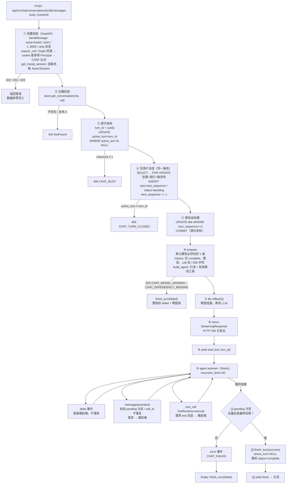
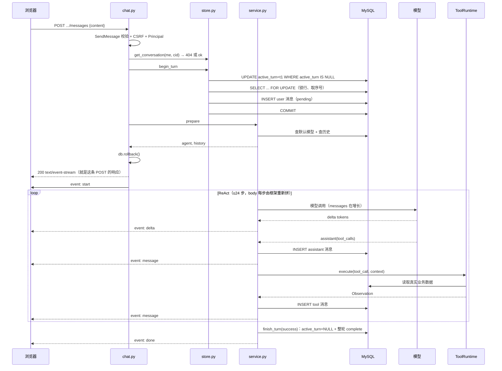
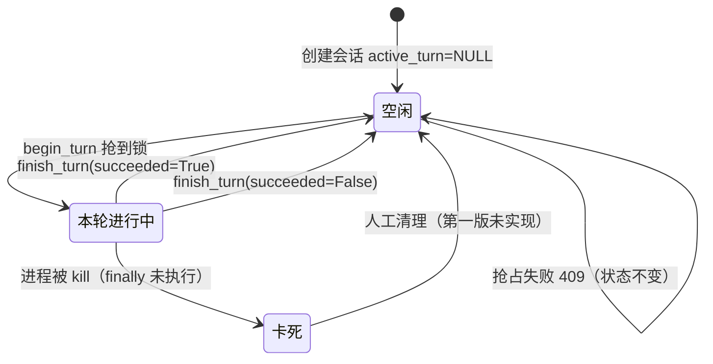
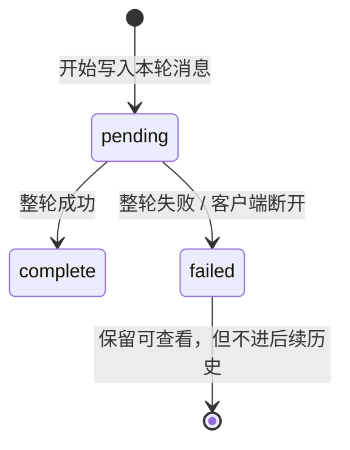

# 聊天接口流程图（第一版实现）

接口：`POST /api/v1/chat/conversations/{conversation_id}/messages`

一次 HTTP 请求，响应即 SSE 流。没有第二条连接。

---

## 1. 主流程



## 2. 时序（注意：只有一条连接）



## 3. 状态机





## 4. 纯文本骨架（不依赖 mermaid 渲染）

```
① 前置校验（FastAPI，未进业务代码）
   body      → SendMessage: extra=forbid, strict, 1..8000, strip 非空
   身份      → cookie → load_session → Principal          (401)
   来源      → Origin 必须同源                            (403)
   CSRF      → cookie + x-csrf-token 比对                 (403)
   数据库    → get_mysql_session 拿 AsyncSession
   任一失败：422 / 401 / 403，数据库无任何写入
        │
        ▼
② 归属校验
   store.get_conversation(me, cid)
   查不到 / 不是我的 → 404（统一，不泄露存在性）
        │
        ▼
③ 原子抢轮 begin_turn
   turn_id = uuid()
   UPDATE chat_conversations SET active_turn=turn_id, updated_at=now
    WHERE id=cid AND user_id=me AND active_turn IS NULL
   rowcount ≠ 1 → 409 CHAT_BUSY
        │
        ▼
④ 写用户消息（与 ③ 同一事务）
   SELECT ... FOR UPDATE（验票 + 锁行 + 取 next_sequence）
   active_turn ≠ turn_id → 409 CHAT_TURN_CLOSED
   INSERT chat_messages(seq=next_sequence, role=user, status=pending)
   next_sequence += 1
   UPDATE title=content[:120] WHERE next_sequence == 2
   COMMIT ← 锁从此归本轮
        │
        ▼
⑤ 准备 prepare
   默认模型配置必须恰好 1 条 → 否则 503 CHAT_MODEL_MISSING
   history = 只取 status=complete 的整轮，≤20 轮 / ≤60000 字符
   build_agent = 只读 + 有权限的工具 + 执行拦截器
   db.rollback() ← 释放连接后再进 LLM
   失败 → finish_turn(failed)（整轮标 failed + 释放锁）→ 抛 503
        │
        ▼
⑥ 返回流（HTTP 200 已定，之后只能发 error 事件）
   StreamingResponse(...) 此刻生成器尚未开始执行
        │
        ▼
⑦ 流式循环（agent.astream, recursion_limit=24）
   ├─ delta            → 直接推前端，不落库
   ├─ message(assistant) → 校验 pending 为空、call_id 不重复 → 落库 → 推前端
   └─ tool_call        → ToolRuntime.execute
                          结构 → 工具存在 → 权限 → 参数 → authorize → 超时执行
                          → Observation → 落库 tool 消息 → 推前端
                          → 回到模型继续（ReAct）
        │
        ▼
⑧ 收尾
   pending 为空 且 有最终回答？
     否 → error 事件 CHAT_FAILED
     是 → finish_turn(success): active_turn=NULL + 整轮 complete → done → 关流
   finally: 未成功 → finish_turn(failed)
```

## 5. 异常出口对照

| 失败点 | HTTP | 数据库最终状态 | 前端看到 |
|---|---|---|---|
| body 不合法 / 多字段 | 422 | 无变化 | 校验错误 |
| 未登录 | 401 | 无变化 | 跳登录 |
| Origin 缺失 / 跨站 / CSRF 失败 | 403 | 无变化 | 提示刷新 |
| 会话不存在 / 非本人 | 404 | 无变化 | 会话不存在 |
| 已有轮在跑 | 409 `CHAT_BUSY` | 无变化 | 会话忙 |
| 轮已被结束 | 409 `CHAT_TURN_CLOSED` | 无变化 | 本轮已结束 |
| 缺 agent 依赖 | 503 `CHAT_DEPENDENCY_MISSING` | 用户消息标 failed | 错误提示 |
| 无唯一默认模型 | 503 `CHAT_MODEL_MISSING` | 用户消息标 failed | 请管理员配置 |
| 流中模型/工具异常 | 200 + `error` 事件 | 整轮 failed，已写消息保留 | error 事件 |
| 客户端断开 | 连接中断 | 整轮 attempted failed | 前端自行判断未完成 |
| 进程在 COMMIT 后被杀 | — | `active_turn` 残留 | 会话永久 busy |

## 6. 代码索引

| 阶段 | 文件 |
|---|---|
| ① 路由与前置校验 | `app/api/routes/chat.py`、`app/auth/dependencies.py` |
| ②③④ 抢轮与写消息 | `app/chat/store.py`（`begin_turn` / `_append`） |
| ⑤ 模型与历史 | `app/chat/service.py`（`prepare`）、`app/chat/agent.py`（`build_agent` / `restore_messages`） |
| ⑥⑦⑧ 流式与收尾 | `app/chat/service.py`（`stream_reply`）、`app/chat/agent.py`（`stream_agent`） |
| 工具执行 | `app/tool_runtime.py`、`app/tools/catalog.py`、`app/tools/order_tools.py` |
| 前端消费 | `app/web/chat.js`（`readEvents` / `send`） |