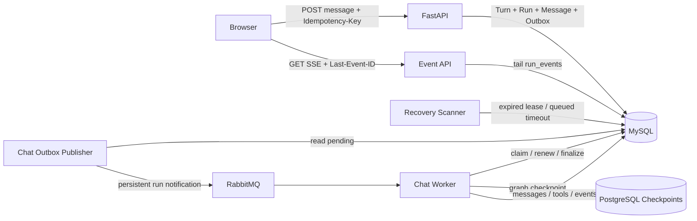

# Agent 会话持久执行链路实施计划

> **For agentic workers:** REQUIRED SUB-SKILL: Use `superpowers:executing-plans` to implement this plan task by task. Steps use checkbox (`- [ ]`) syntax for tracking. Do not create a worktree, commit, push, apply a database migration, or change deployment configuration unless the user explicitly authorizes that action.

**Goal:** 将当前“POST 请求直接执行 Agent 并返回 SSE”的聊天 Demo，改造成由后台 Worker 持久执行、RabbitMQ 调度、租约接管、LangGraph 检查点恢复、SSE 可断线重放的生产型会话链路。

**Architecture:** 用户请求在 MySQL 事务中创建 Turn、Run、用户消息和 OutboxEvent，API 返回 `202`；Outbox Publisher 将 `run_id` 发布到 RabbitMQ，Chat Worker 通过数据库租约领取并执行 Run。LangGraph durable Checkpointer 保存图执行状态，MySQL 保存业务状态、工具执行、消息和可重放事件；SSE 只观察 `run_events`，不拥有 Agent 执行生命周期。

**Tech Stack:** Python 3.11+、FastAPI、SQLAlchemy Async、MySQL 8.4、RabbitMQ/aio-pika、LangChain/LangGraph、LangGraph PostgreSQL Checkpointer、PostgreSQL、原生 JavaScript EventSource。

---

## 0. 文档状态与执行约束

- 设计状态：已完成产品决策，可作为实现基线。
- 当前动作：只创建执行文档，不修改代码、数据库、环境配置或部署文件。
- 数据库迁移执行、`docker-compose.yml` 修改、环境变量修改属于需要用户确认的操作。
- 现有工作区存在用户改动；执行时不得覆盖或回滚无关文件。
- 当前项目业务库是 MySQL，不是 PostgreSQL。
- 官方 LangGraph 当前提供生产型 PostgreSQL Checkpointer 和开发型 SQLite Checkpointer，没有官方 MySQL Saver。因此本计划推荐：
  - MySQL 保存聊天业务数据；
  - PostgreSQL 只保存 LangGraph checkpoint、checkpoint blob 和 pending writes；
  - 不在第一版自研 MySQL Checkpointer，也不把 SQLite 用于生产。
- 如果项目最终拒绝增加 PostgreSQL，必须在 Task 1 停止，重新评审“第三方 MySQL Saver”或“自研 BaseCheckpointSaver”；不得直接将社区实现带入生产。

参考：

- [LangGraph Checkpoint 基础接口](https://github.com/langchain-ai/langgraph/blob/main/libs/checkpoint/README.md)
- [LangGraph PostgreSQL Checkpointer](https://github.com/langchain-ai/langgraph/blob/main/libs/checkpoint-postgres/README.md)
- [RabbitMQ Publisher Confirms 与 Consumer Acknowledgements](https://www.rabbitmq.com/docs/confirms)
- [RabbitMQ Quorum Queues](https://www.rabbitmq.com/docs/quorum-queues)

---

## 1. 已确认的产品规则

### 1.1 Turn 与 Run

- Turn 表示一次用户意图。
- Run 表示完成该 Turn 的一次完整执行尝试。
- 新用户消息创建新 Turn 和初始 Run。
- SSE 重连、RabbitMQ 重复投递、Worker 崩溃接管继续使用原 Run。
- Run 进入终态后，用户点击失败重试、取消后重试或重新生成时，在原 Turn 下创建新 Run。
- 用户重新编辑并发送一条消息时创建新 Turn。
- 第一版不支持从旧 Turn 派生对话分支。
- 只有 Conversation 最新 Turn 可以重新执行；后续 Turn 已存在时拒绝重跑旧 Turn。

### 1.2 并发与取消

- 同一个 Conversation 同时只能有一个 active Turn。
- 浏览器关闭、刷新、切网只影响观察连接，不取消 Run。
- 用户点击停止才触发业务取消：`running -> cancelling -> cancelled`。
- 取消不撤销已经发生的外部副作用。

### 1.3 恢复与重试

- Worker 崩溃后由租约过期、Recovery Scanner、RabbitMQ 重新调度同一个 Run。
- Turn 的 Run 次数、Run 的恢复次数、ToolExecution 的调用次数必须分开记录。
- `max_run_attempts` 包含第一次执行。
- 只读或可靠幂等工具可以自动重试。
- 能按幂等键查询外部状态的工具先 reconcile。
- 副作用结果未知且无法 reconcile 时进入 `requires_attention`，禁止盲目重试。

### 1.4 事件与消息

- `messages` 保存对话内容和模型协议消息。
- `run_events` 保存观察事件和 SSE 重放数据。
- `tool_executions` 保存工具执行、幂等、重试和审计元数据。
- Delta 事件先持久化再发送；允许批量合并，避免逐 token 写数据库。
- 最终 `response.completed` 事件必须携带权威完整文本，用于修复进程崩溃前遗漏的最后一批 delta。

---

## 2. 目标链路



### 2.1 数据源职责

| 数据源 | 职责 | 不能承担的职责 |
|---|---|---|
| MySQL | Turn、Run、工具执行、消息、事件、Outbox、租约、最终业务状态 | 不保存 LangGraph 内部图状态副本 |
| PostgreSQL Checkpointer | 图状态、checkpoint、pending writes、节点恢复位置 | 不作为前端状态接口，不替代 Run 状态 |
| RabbitMQ | 通知 Worker 某个 Run 可以尝试领取 | 不作为 Run 状态或执行历史真相 |
| SSE | 传输已持久化事件 | 不推进 Agent，不决定 Run 是否存活 |

---

## 3. 状态机与不变量

### 3.1 Turn 状态

```text
active
completed
failed
cancelled
requires_attention
```

允许转换：

```text
active -> completed | failed | cancelled | requires_attention
failed | cancelled | completed -> active       创建新 Run
requires_attention -> active                    人工处理后恢复或创建新 Run
```

### 3.2 Run 状态

```text
queued
running
recovering
requires_attention
cancelling
completed
failed
cancelled
```

终态为：

```text
completed
failed
cancelled
```

终态 Run 不允许恢复为 `running`。再次完整执行必须创建新 Run。

### 3.3 核心不变量

1. 一个 Conversation 最多一个 `active_turn`。
2. 一个 Turn 最多一个非终态 Run。
3. `turn.latest_run_id` 始终指向最新 Run，终态后仍保留。
4. `turn.active_run_id` 只在 Run 非终态时有值。
5. `run.attempt_no` 在 Turn 内唯一且从 1 递增。
6. `run_events.seq` 在 Run 内严格递增且不可修改。
7. 一个 `(run_id, tool_call_id)` 只能有一条 ToolExecution。
8. Worker 的关键写入必须同时匹配 `lease_owner` 和 `lease_generation`。
9. Run 完成事务必须同时写最终事件、Run 终态、Turn 终态并释放 `conversation.active_turn`。
10. 只有 Turn 选中的已完成 Run 可以进入下一轮模型历史。

---

## 4. 数据模型

### 4.1 `chat_turns`

| 字段 | 类型建议 | 说明 |
|---|---|---|
| `id` | `VARCHAR(36)` PK | turn_id |
| `conversation_id` | FK | 所属会话 |
| `user_message_id` | FK | 原始用户消息 |
| `turn_no` | INT | Conversation 内顺序 |
| `status` | VARCHAR(32) | Turn 状态 |
| `latest_run_id` | nullable FK | 最新一次 Run，终态后保留 |
| `active_run_id` | nullable FK | 当前非终态 Run |
| `run_count` | INT | 已创建 Run 数 |
| `max_run_attempts` | INT | 包含初始 Run |
| `client_request_id` | VARCHAR(100) | 提交幂等键 |
| `created_at/updated_at/closed_at` | DATETIME | 时间字段 |

约束：

```text
UNIQUE(conversation_id, turn_no)
UNIQUE(conversation_id, client_request_id)
```

### 4.2 `chat_runs`

| 字段 | 类型建议 | 说明 |
|---|---|---|
| `id` | `VARCHAR(36)` PK | run_id |
| `turn_id` | FK | 所属 Turn |
| `attempt_no` | INT | Turn 下第几次完整执行 |
| `retry_of_run_id` | nullable FK | 前一次 Run |
| `trigger_reason` | VARCHAR(32) | initial/failure_retry/cancel_retry/regenerate |
| `status` | VARCHAR(32) | Run 状态 |
| `agent_version` | VARCHAR(100) | Agent/prompt 版本 |
| `checkpoint_thread_id` | VARCHAR(255) | 固定为 run_id |
| `latest_checkpoint_id` | nullable VARCHAR(255) | 最近观察到的 checkpoint |
| `checkpoint_schema_version` | VARCHAR(50) | 状态结构版本 |
| `lease_owner` | nullable VARCHAR(100) | Worker ID |
| `lease_expires_at` | nullable DATETIME | 租约截止 |
| `last_heartbeat_at` | nullable DATETIME | 最近心跳 |
| `lease_generation` | BIGINT | fencing token |
| `recovery_count` | INT | 基础设施恢复次数 |
| `max_recovery_count` | INT | 最大自动恢复次数 |
| `next_event_seq` | BIGINT | 下一条 RunEvent 序号 |
| `error_code/error_message` | nullable | 稳定错误信息 |
| `queued_at/started_at/finished_at` | nullable DATETIME | 生命周期时间 |
| `created_at/updated_at` | DATETIME | 审计时间 |

约束：

```text
UNIQUE(turn_id, attempt_no)
INDEX(status, lease_expires_at)
INDEX(status, queued_at)
```

### 4.3 `chat_tool_executions`

| 字段 | 类型建议 | 说明 |
|---|---|---|
| `id` | `VARCHAR(36)` PK | 执行记录 ID |
| `run_id` | FK | 所属 Run |
| `model_response_id` | VARCHAR(100) | 产生调用的模型响应 |
| `assistant_message_id` | nullable FK | 对应 assistant 协议消息 |
| `tool_batch_id` | VARCHAR(100) | 同一次模型响应的工具批次 |
| `tool_call_id` | VARCHAR(200) | 模型工具调用 ID |
| `call_index` | INT | 原模型调用顺序 |
| `tool_name/tool_version` | VARCHAR | 工具身份 |
| `arguments_json` | JSON | 参数 |
| `arguments_hash` | VARCHAR(64) | 兼容性和复用判断 |
| `status` | VARCHAR(32) | pending/running/succeeded/failed/unknown/requires_attention/cancelled |
| `result_json` | nullable JSON | 小结果内联 |
| `result_ref` | nullable VARCHAR | 大结果外部引用 |
| `result_hash` | nullable VARCHAR(64) | 结果校验 |
| `idempotency_key` | nullable VARCHAR(200) | 外部操作幂等键 |
| `attempt_count/max_attempts` | INT | 工具自身尝试次数 |
| `reused_from_execution_id` | nullable FK | 跨 Run 复用来源 |
| `error_code/error_message` | nullable | 错误分类 |
| `started_at/finished_at/created_at/updated_at` | DATETIME | 时间字段 |

约束：

```text
UNIQUE(run_id, tool_call_id)
INDEX(run_id, tool_batch_id, call_index)
```

### 4.4 `chat_run_events`

| 字段 | 类型建议 | 说明 |
|---|---|---|
| `id` | `VARCHAR(36)` PK | 事件记录 ID |
| `run_id` | FK | 所属 Run |
| `seq` | BIGINT | Run 内递增序号 |
| `event_type` | VARCHAR(64) | SSE event 名 |
| `payload_json` | JSON | 事件内容 |
| `model_response_id` | nullable VARCHAR | 模型响应关联 |
| `response_segment_id` | nullable VARCHAR | 流式重试段 |
| `created_at` | DATETIME | 创建时间 |
| `expires_at` | nullable DATETIME | 事件清理时间 |

约束：

```text
UNIQUE(run_id, seq)
INDEX(run_id, created_at)
INDEX(expires_at)
```

### 4.5 `chat_outbox_events`

| 字段 | 类型建议 | 说明 |
|---|---|---|
| `id` | `VARCHAR(36)` PK | Outbox ID |
| `aggregate_type` | VARCHAR(32) | 固定为 run |
| `aggregate_id` | VARCHAR(36) | run_id |
| `event_type` | VARCHAR(64) | run.created/recovery_requested/cancel_requested |
| `payload_json` | JSON | 小型通知载荷 |
| `deduplication_key` | VARCHAR(200) | 去重键 |
| `status` | VARCHAR(16) | pending/publishing/published/dead |
| `attempt_count` | INT | 发布尝试次数 |
| `available_at` | DATETIME | 下次可发布时间 |
| `locked_by/locked_at` | nullable | Publisher 领取信息 |
| `last_error` | nullable TEXT | 脱敏错误摘要 |
| `created_at/published_at` | DATETIME | 时间字段 |

约束：

```text
UNIQUE(deduplication_key)
INDEX(status, available_at)
```

### 4.6 `chat_messages` 调整

- 保留 `turn_id`。
- 新增 nullable `run_id`。
- 新增 nullable `source_key`，用于模型消息/工具消息幂等投影。
- 用户消息 `run_id = NULL`。
- Assistant 和 Tool 协议消息带 `run_id`。
- `status` 在兼容期保留，但不再作为 Run/Turn 状态真相。
- 历史查询改为基于已完成 Turn 选中的 Run，不再依赖 `messages.status`。

建议约束：

```text
UNIQUE(run_id, source_key)
INDEX(conversation_id, turn_id, run_id, sequence)
```

---

## 5. 文件结构锁定

### 5.1 新建文件

```text
app/chat/contracts.py                 状态枚举、事件类型、稳定错误码
app/chat/lifecycle.py                 Turn/Run/lease/fencing 状态转换
app/chat/events.py                    RunEvent 分配、批量写入、SSE 编码
app/chat/checkpoints.py               AsyncPostgresSaver 生命周期和配置
app/chat/executor.py                  单个 Run 的 Agent 执行与最终投影
app/chat/tool_execution.py            工具执行记录、幂等、reconcile、复用
app/chat/outbox_publisher.py           Chat Outbox 发布器
app/chat/worker.py                     RabbitMQ 消费、领取、ACK、执行
app/chat/recovery.py                   过期租约扫描和重新调度
app/messaging/chat_topology.py         Chat 专用 exchange/queue/DLQ
app/cli/chat_worker.py                 独立 Worker 入口
app/cli/chat_outbox.py                 独立 Publisher 入口
app/cli/chat_recovery.py               独立 Scanner 入口
migrations/20261029_durable_chat.sql   MySQL 显式迁移
tests/test_chat_lifecycle.py           状态机、租约、fencing
tests/test_chat_outbox.py              Outbox 和重复发布
tests/test_chat_worker.py              领取、ACK、重复投递
tests/test_chat_recovery.py            宕机接管、A/B/C 恢复
tests/test_chat_events.py              seq、重放、delta 合并
tests/test_chat_checkpoint_recovery.py Checkpointer 与最终投影
```

### 5.2 修改文件

```text
pyproject.toml                         加 Checkpointer/PostgreSQL 依赖
docker-compose.yml                     增加 checkpoint PostgreSQL 服务（需确认）
.env.example                           增加 checkpoint 和 Chat Worker 配置（需确认）
app/core/config.py                     新配置字段
app/chat/models.py                     五张表和 Message 字段
app/chat/store.py                      提交、查询、历史和幂等事务
app/chat/agent.py                      注入 checkpointer 和 durable config
app/chat/service.py                    去除执行型 stream_reply，保留应用服务
app/api/routes/chat.py                 202、Run 状态、SSE、取消、重试接口
app/cli/chat_schema.py                 新迁移和只读结构校验
app/bootstrap.py                       探测 Chat Rabbit/PostgreSQL readiness
app/main.py                            本地模式启动 Chat 后台组件
app/web/chat.js                        POST 后 EventSource、重连、取消、重试
app/web/chat.css                       Run 状态和控制按钮
app/web/index.html                     停止/重试控件
tests/test_chat_api.py                 新 API 合约
tests/test_chat_store.py               新 Turn/Run 历史语义
tests/chat_frontend.test.cjs           重连、Last-Event-ID、reset、取消
docs/agent-chat-guide.md               运行和运维说明
```

现有 `app/worker.py`、`app/messaging/outbox_publisher.py` 和 `app/db/task_lifecycle.py` 属于 RAG/A1，不直接塞入 Chat 分支。Chat 实现复用它们的模式，使用独立 queue、routing key、配置和代码文件，避免两个领域互相影响。

---

## 6. 分阶段执行任务

### Task 1：检查点后端验证与依赖锁定

**Files:**

- Modify: `pyproject.toml`
- Create: `app/chat/checkpoints.py`
- Test: `tests/test_chat_checkpoint_recovery.py`

- [ ] 确认当前 `langchain==1.4.7` 传递安装的 LangGraph 版本和 `create_agent(checkpointer=...)` 接口。
- [ ] 在独立 PostgreSQL 测试库调用 `AsyncPostgresSaver.setup()`，确认建表权限和连接参数。
- [ ] 验证 `thread_id=run_id`、`checkpoint_id`、pending writes 和异步恢复接口。
- [ ] 启用严格序列化限制：`LANGGRAPH_STRICT_MSGPACK=true` 或显式 `allowed_msgpack_modules`，避免不受限反序列化。
- [ ] 固定兼容的 `langgraph-checkpoint-postgres` 与 `psycopg` 版本范围。
- [ ] 写最小恢复验证：一个节点成功、下一节点抛错，重新执行时已成功节点不重复运行。
- [ ] 记录结论；验证失败时停止后续实现，不使用内存 Saver 或生产 SQLite 替代。

**验收：** 进程关闭并重新创建 Saver 后，可以用同一 `run_id` 读取 checkpoint 和 pending writes。

### Task 2：MySQL 显式迁移与 ORM 模型

**Files:**

- Create: `migrations/20261029_durable_chat.sql`
- Modify: `app/chat/models.py`
- Modify: `app/cli/chat_schema.py`
- Test: `tests/test_chat_store.py`

- [ ] 编写只增加结构、不删除旧数据的迁移 SQL。
- [ ] 创建 `chat_turns`、`chat_runs`、`chat_tool_executions`、`chat_run_events`、`chat_outbox_events`。
- [ ] 为 `chat_messages` 添加 nullable `run_id` 和 `source_key`。
- [ ] 增加外键、唯一约束、租约扫描索引和事件重放索引。
- [ ] 在 ORM 中定义对应模型和枚举值。
- [ ] 扩展 `chat_schema check`，校验字段、外键、唯一约束和索引。
- [ ] 保证应用启动仍只做只读 schema 校验，不自动 ALTER 业务表。
- [ ] 在执行迁移前暂停并请求用户确认。

**验收：** 空库应用迁移后校验通过；已有 `chat_conversations/chat_messages` 数据仍可读取。

### Task 3：提交事务、幂等键和 Conversation 占用

**Files:**

- Create: `app/chat/contracts.py`
- Modify: `app/chat/store.py`
- Modify: `app/chat/service.py`
- Test: `tests/test_chat_store.py`

- [ ] 实现 `create_turn_and_initial_run()`，在一个 MySQL 事务中创建用户消息、Turn、Run 和 OutboxEvent。
- [ ] 使用条件更新或行锁保证 `conversation.active_turn IS NULL`。
- [ ] 以 `(conversation_id, client_request_id)` 保证提交幂等。
- [ ] 相同幂等键重试返回原 `turn_id/run_id`，不重复插入用户消息。
- [ ] 生成 `turn_no=上一轮+1` 和 `attempt_no=1`。
- [ ] 设置 `turn.latest_run_id`、`turn.active_run_id`、`conversation.active_turn`。
- [ ] 首轮标题更新仍与提交事务绑定，并对换行和长度做规范化。
- [ ] 保持事务内不调用模型、工具、RabbitMQ 或 PostgreSQL。

**验收：** 两个并发提交最多一个成功；响应丢失后用同一幂等键重试返回相同 ID。

### Task 4：Run 生命周期、租约和 fencing

**Files:**

- Create: `app/chat/lifecycle.py`
- Modify: `app/chat/store.py`
- Test: `tests/test_chat_lifecycle.py`

- [ ] 实现 `claim_run()`，只允许领取 queued、recovering 或租约已过期的非终态 Run。
- [ ] 领取时写入 `lease_owner`、`lease_expires_at`、`last_heartbeat_at` 并递增 `lease_generation`。
- [ ] 实现 `renew_run_lease()`，条件必须包含 run_id、owner、generation 和允许状态。
- [ ] 实现 `assert_run_ownership()`，所有 Worker 写入前验证 fencing。
- [ ] 实现 completed/failed/requires_attention/cancelling/cancelled 的合法转换。
- [ ] 完成 Run 时在同一事务更新 Run、Turn、Conversation 和终态 RunEvent。
- [ ] 终态后清空 `turn.active_run_id` 与 `conversation.active_turn`，保留 `turn.latest_run_id`。
- [ ] 验证旧 Worker 在新 generation 接管后无法写消息、事件、工具结果或终态。

**验收：** 租约过期后只有一个新 Worker 能成功接管；旧 generation 的写操作影响行数为 0 并转成 `ExecutionLost`。

### Task 5：Chat RabbitMQ topology 与 Outbox Publisher

**Files:**

- Create: `app/messaging/chat_topology.py`
- Create: `app/chat/outbox_publisher.py`
- Modify: `app/core/config.py`
- Test: `tests/test_chat_outbox.py`

- [ ] 定义 Chat 专用 exchange、routing key、queue、DLX 和 dead queue。
- [ ] 消息体只包含 `run_id`、`dispatch_reason`、`dispatch_generation` 和 schema version。
- [ ] 声明 durable exchange/queue、persistent message、mandatory publish 和 publisher confirms。
- [ ] Outbox Publisher 使用短事务领取到期记录，设置 publishing 锁和超时回收。
- [ ] 收到 broker confirm 后把 Outbox 标记 published。
- [ ] confirm 不确定、进程崩溃或 RabbitMQ 不可用时保留可重试状态并指数退避。
- [ ] 达到发布上限后标记 dead 并输出不含敏感数据的结构化告警。
- [ ] 允许重复发布；不依赖 RabbitMQ message_id 实现唯一执行。

**验收：** MySQL 提交成功而 RabbitMQ 暂停时 Run 保持 queued；RabbitMQ 恢复后无需用户请求即可补发。

### Task 6：Worker 消费、数据库领取与 ACK 边界

**Files:**

- Create: `app/chat/worker.py`
- Create: `app/cli/chat_worker.py`
- Test: `tests/test_chat_worker.py`

- [ ] 校验 RabbitMQ payload 结构，畸形消息 reject 且不 requeue。
- [ ] 收到合法消息后先尝试 MySQL 原子领取 Run。
- [ ] Run 已终态、已有有效租约或 dispatch generation 已过时则安全 ACK。
- [ ] 领取成功并提交 MySQL 后 ACK RabbitMQ 消息。
- [ ] ACK 后执行 Run；后续可靠性由租约、checkpoint 和 Scanner 承担。
- [ ] 设置 prefetch 和本地并发信号量，避免一个 Worker 领取超出处理能力的 Run。
- [ ] Worker 关闭时停止领取新消息，停止续租并等待安全边界；未完成 Run 由租约恢复。
- [ ] DB 在领取前不可用时 NACK/requeue 并退避，避免紧循环。

**验收：** 同一消息重复投递十次只产生一个有效 lease generation；终态 Run 的重复消息会 ACK 且不执行 Agent。

### Task 7：Agent Checkpointer 接入与执行器

**Files:**

- Modify: `app/chat/agent.py`
- Create: `app/chat/executor.py`
- Modify: `app/chat/service.py`
- Test: `tests/test_chat_checkpoint_recovery.py`

- [ ] 让 `build_agent()` 接受 durable checkpointer，并以 `run_id` 作为 `thread_id`。
- [ ] Agent 状态中保留完整 messages、当前模型响应、工具调用、执行节点和恢复所需字段。
- [ ] 在 Run 启动时加载选中历史：用户消息加此前已完成 Turn 的 selected Run 消息。
- [ ] 运行期间启动独立 heartbeat coroutine；续租失败立即停止提交新工作。
- [ ] 模型流开始时生成 `response_segment_id` 并写 `response.started`。
- [ ] 模型流在形成 checkpoint 前失败时写 `response.restarted/text.reset`，恢复后重新生成该段。
- [ ] 模型最终 AIMessage checkpoint 后，通过幂等 projector 写 Assistant Message 和 `response.completed`。
- [ ] `response.completed` 携带完整权威文本，前端用它替换可能缺失的 delta 拼接结果。
- [ ] 最终 projector 可从 checkpoint 重建缺失的最终 Message，解决 PostgreSQL checkpoint 已提交但 MySQL 消息尚未写入的跨库窗口。

**验收：** 在“最终 checkpoint 已写、MySQL 最终消息未写”位置模拟崩溃，恢复后只补写一条最终 Assistant Message 并正常完成 Run。

### Task 8：工具执行持久化、A/B/C 恢复和副作用策略

**Files:**

- Create: `app/chat/tool_execution.py`
- Modify: `app/chat/agent.py`
- Modify: `app/tool_runtime.py`
- Test: `tests/test_chat_recovery.py`

- [ ] 模型产生工具批次后，在执行工具前记录 `model_response_id/tool_batch_id/tool_call_id/call_index`。
- [ ] ToolExecution 的插入使用 `(run_id, tool_call_id)` 幂等约束。
- [ ] 调用工具前把 pending 转 running 并增加 `attempt_count`。
- [ ] 工具完成后先持久化结果，再把 ToolMessage 交回 Agent 图。
- [ ] 同 Run 恢复时，succeeded 工具直接返回已保存结果；pending 工具继续执行。
- [ ] 工具结果已发生但保存不确定时，根据工具策略进入 reconcile 或 requires_attention。
- [ ] 为写工具派生稳定 idempotency key，模型不得自行生成该键。
- [ ] 跨 Run 复用必须校验工具版本、参数 hash、结果时效和副作用策略，并记录 `reused_from_execution_id`。
- [ ] 恢复 A/B/C 场景：A succeeded，B/C pending；新 Worker 不重新调用模型规划，也不重新执行 A。
- [ ] 工具协议消息按 `call_index` 写入/恢复，避免并行完成顺序破坏模型协议。

**验收：** A 工具调用次数为 1，B/C 在接管后各执行一次，恢复后的模型上下文包含同一批次的三个有序 ToolMessage。

### Task 9：RunEvent 持久化、序号和 SSE 重放

**Files:**

- Create: `app/chat/events.py`
- Modify: `app/chat/store.py`
- Modify: `app/api/routes/chat.py`
- Test: `tests/test_chat_events.py`

- [ ] 使用 Run 行锁和 `next_event_seq` 批量分配严格递增 seq。
- [ ] 事件写入同时验证 lease generation；观察层不需要持有租约。
- [ ] 将连续 `text.delta` 按时间或大小批量合并后写入。
- [ ] SSE 返回 `id: seq`、`event: event_type` 和 JSON `data`。
- [ ] 读取 `Last-Event-ID` 请求头；可选 query 参数只用于不支持 header 的调试客户端。
- [ ] 先发送历史事件，再轮询/长轮询新事件，始终按 seq 排序。
- [ ] 发送不落库的 SSE heartbeat 注释，避免代理空闲断开。
- [ ] 多个观察者可以同时读取，不修改 Run 状态。
- [ ] 收到 Run 终态事件并发送完所有 seq 后正常关闭连接。
- [ ] 对非法、越权或属于其他用户的 run_id 返回 404，避免泄漏存在性。

**验收：** 客户端收到 seq 1～20 后断线，以 Last-Event-ID 20 重连只收到 21 以后事件，无重复文本且最终内容与 Message 一致。

### Task 10：HTTP API 合约切换

**Files:**

- Modify: `app/api/routes/chat.py`
- Modify: `app/chat/service.py`
- Modify: `tests/test_chat_api.py`

- [ ] `POST /api/v1/chat/conversations/{conversation_id}/messages` 改为创建 Turn/Run 并返回 `202` JSON。
- [ ] 从 `Idempotency-Key` 读取客户端幂等键；缺失或格式不合法返回 422。
- [ ] 返回 `conversation_id/turn_id/run_id/status/events_url`。
- [ ] 新增 `GET /api/v1/chat/runs/{run_id}`，返回可靠业务状态而不是推测 Worker 存活。
- [ ] 新增 `GET /api/v1/chat/runs/{run_id}/events` SSE。
- [ ] 新增 `POST /api/v1/chat/runs/{run_id}/cancel`。
- [ ] 新增 `POST /api/v1/chat/turns/{turn_id}/runs`，接受明确 trigger reason。
- [ ] 新增 `GET /api/v1/chat/turns/{turn_id}/runs` 用于执行历史。
- [ ] 保留会话和消息归属校验、CSRF 策略和跨用户 404 语义。
- [ ] 删除 POST 路由对 `StreamingResponse(service.stream_reply(...))` 的依赖。

**验收：** POST 在 Agent 尚未开始时即可返回 202；关闭 POST 连接不会改变 Run 状态或 Worker 执行。

### Task 11：取消、重新生成和历史选择

**Files:**

- Modify: `app/chat/lifecycle.py`
- Modify: `app/chat/store.py`
- Modify: `app/api/routes/chat.py`
- Test: `tests/test_chat_lifecycle.py`

- [ ] cancel 使用 CAS 把 running/recovering 变为 cancelling，并写 cancel_requested OutboxEvent。
- [ ] Worker 在模型调用前、工具调用前后、事件 flush 和 checkpoint 边界检查取消。
- [ ] Worker 到安全边界后完成 cancelled 事务并释放 Conversation。
- [ ] 创建新 Run 前验证 Turn 是 Conversation 最新 Turn、没有 active Run、未超过 max_run_attempts。
- [ ] 新 Run 使用新 checkpoint thread，设置 `retry_of_run_id` 和 trigger reason。
- [ ] 新 Run 创建后更新 latest_run_id、active_run_id 和 conversation.active_turn。
- [ ] 历史只使用每个已完成 Turn 的 latest/selected completed Run，不读失败 Run 的不完整协议消息。
- [ ] Message 列表默认展示当前选中 Run；旧 Run 通过 runs 历史接口查看。

**验收：** cancelled Run 保持不可变；点击重新生成创建同 Turn 的 attempt_no+1；发送新文本创建新 Turn。

### Task 12：Recovery Scanner 和无人请求恢复

**Files:**

- Create: `app/chat/recovery.py`
- Create: `app/cli/chat_recovery.py`
- Test: `tests/test_chat_recovery.py`

- [ ] 扫描长时间 queued 且没有有效投递的 Run。
- [ ] 扫描 running/recovering/cancelling 且 lease 已过期的 Run。
- [ ] 使用行锁或条件更新保证多个 Scanner 不重复推进同一恢复代次。
- [ ] 增加 recovery_count，并创建带去重键的 recovery_requested OutboxEvent。
- [ ] 达到 max_recovery_count 后，根据最后工具状态转 failed 或 requires_attention。
- [ ] DB 恢复后 Scanner 自动继续，不依赖任何 HTTP 请求。
- [ ] Scanner 重启后根据数据库状态继续工作，不依赖内存定时器。
- [ ] 对 checkpoint 版本不兼容的 Run 设置稳定错误码 `CHECKPOINT_VERSION_UNSUPPORTED`。

**验收：** API、Worker 全部停止后重启 Worker/Scanner，不发任何用户请求；租约到期后原 Run 自动恢复。

### Task 13：前端 EventSource、重连和控制操作

**Files:**

- Modify: `app/web/chat.js`
- Modify: `app/web/chat.css`
- Modify: `app/web/index.html`
- Modify: `tests/chat_frontend.test.cjs`

- [ ] 发送时生成稳定 Idempotency-Key；同一次未知结果重试复用该键。
- [ ] POST 202 后保存 run_id，并使用 EventSource 连接 events_url。
- [ ] 维护最后 seq，断线后重新连接并补读事件。
- [ ] 断线期间显示“重新连接中”，不把 Run 标记为失败。
- [ ] 连接失败时调用 GET Run 判断 queued/running/recovering/terminal。
- [ ] 处理 `response.restarted/text.reset`，清空对应 segment 的临时文本。
- [ ] 处理 `response.completed`，以完整权威文本替换 delta 草稿。
- [ ] 停止按钮调用 cancel；状态显示 cancelling，收到 cancelled 后解锁输入。
- [ ] 失败、取消和完成后按业务规则展示重试/重新生成按钮。
- [ ] 账号或会话切换关闭 EventSource，并保留现有 RequestScope 防迟到响应逻辑。
- [ ] 多标签页观察同一 Run 时不重复提交消息。

**验收：** 页面在模型执行中刷新后能识别 active Run、重连、补齐事件并显示最终回答。

### Task 14：运行方式、readiness 和部署拆分

**Files:**

- Modify: `app/core/config.py`
- Modify: `app/bootstrap.py`
- Modify: `app/main.py`
- Create: `app/cli/chat_outbox.py`
- Modify: `.env.example`
- Modify: `docker-compose.yml`
- Test: `tests/test_app_lifespan.py`

- [ ] 增加 Chat queue、lease、heartbeat、recovery、event batch、retention 和 PostgreSQL checkpoint 配置。
- [ ] 本地开发允许 FastAPI lifespan 启动 Chat Publisher/Worker/Scanner。
- [ ] 生产运行文档要求 API、Publisher、Worker、Scanner 分成独立进程。
- [ ] readiness 分别报告 MySQL、RabbitMQ 和 Checkpoint PostgreSQL 状态，不把 Elasticsearch/MinIO 作为 Chat 执行必要条件。
- [ ] API 在 RabbitMQ 暂时不可用时仍允许提交并落 Outbox，但 readiness/状态接口应准确反映排队原因。
- [ ] Worker 使用唯一实例 ID，日志统一包含 run_id、turn_id、lease_generation、worker_id。
- [ ] 修改 `docker-compose.yml`、环境配置或部署服务前请求用户确认。

**验收：** 只停止 API 不影响 Worker；只停止 RabbitMQ 不丢 Run；只停止 Worker 时 Run 保持 queued 或等待租约恢复。

### Task 15：可观测性、保留策略和运维处置

**Files:**

- Modify: `app/chat/executor.py`
- Modify: `app/chat/recovery.py`
- Modify: `docs/agent-chat-guide.md`
- Test: `tests/test_chat_recovery.py`

- [ ] 结构化日志记录 request_id、conversation_id、turn_id、run_id、worker_id、lease_generation、event_type 和耗时，不记录消息正文或凭据。
- [ ] 记录 Run 成功率、失败码、恢复次数、模型延迟、工具延迟、SSE 重连和 Outbox 积压指标。
- [ ] 定义 run_events 终态后保留期；清理前保证最终 Message 和 Run 终态仍可查询。
- [ ] LangGraph checkpoint 保留至少覆盖 Run 审计和故障处理窗口，清理时按 run_id 删除整条 thread。
- [ ] 为 dead Outbox、DLQ、requires_attention、连续租约过期建立运维查询和告警说明。
- [ ] 文档说明如何安全处理 unknown 工具结果和如何重新投递 queued Run。
- [ ] 不提供绕过 fencing 或直接把 Run 改成 completed 的管理快捷方式。

**验收：** 运维人员仅依靠 run_id 就能定位 MySQL 状态、Rabbit 投递、Worker owner、checkpoint thread 和最后工具记录。

### Task 16：兼容迁移、灰度切换与旧链路清理

**Files:**

- Modify: `app/api/routes/chat.py`
- Modify: `app/chat/service.py`
- Modify: `app/chat/store.py`
- Modify: `app/web/chat.js`
- Modify: `docs/agent-chat-guide.md`

- [ ] 第一阶段只部署新表和只读 schema 校验，不切换流量。
- [ ] 第二阶段部署 Publisher、Worker、Scanner，但旧 POST 仍可通过功能开关运行。
- [ ] 第三阶段将前端切到 202 + EventSource，并观察 queued、failed、recovery 指标。
- [ ] 确认新链路稳定后停止创建旧式 message.status 执行状态。
- [ ] 最后删除 `service.stream_reply()` 和 POST 内 StreamingResponse 路径。
- [ ] 旧消息保持可读；不为历史旧 Turn 伪造 checkpoint 或 ToolExecution。
- [ ] 回滚时只切回旧入口，不删除新表、不丢弃已创建 Run；后台组件先停止领取，再等待租约自然结束。
- [ ] 数据字段删除属于后续独立迁移，不纳入本次切换。

**验收：** 灰度期间新旧会话均可读取；回滚不会造成同一个 Run 被旧链路和 Worker 同时执行。

---

## 7. 关键事务边界

### 7.1 提交事务

必须在一个 MySQL 事务完成：

```text
claim conversation.active_turn
insert user message
insert turn
insert initial run
insert run.queued event
insert outbox event
commit
```

不得在该事务中访问模型、RabbitMQ 或 PostgreSQL。

### 7.2 Worker 领取事务

```text
lock/CAS run
validate status and lease
set owner, lease, generation, running
append run.started
commit
RabbitMQ ACK
```

### 7.3 工具完成事务

```text
validate owner + generation
persist tool result
append tool.completed
persist tool protocol message using source_key
commit
return ToolMessage to graph
```

### 7.4 Run 完成事务

```text
validate owner + generation
project final assistant message idempotently
append response.completed if missing
append run.completed
set run.completed
set turn.completed, clear active_run_id
clear conversation.active_turn
commit
```

### 7.5 MySQL 与 PostgreSQL 的非原子边界

不引入分布式事务。通过以下规则收敛：

1. 模型计划先进入 checkpoint，再允许工具节点推进。
2. 工具结果先进入 MySQL，再返回给图；恢复时按 tool_call_id 复用。
3. 最终 Assistant Message 通过 source_key 幂等投影。
4. checkpoint 显示图已完成但 MySQL Run 未终态时，恢复器运行 final projector。
5. MySQL Run 已终态后拒绝任何旧 Worker 写入，即使 PostgreSQL 还有后续 pending write。
6. Run 终态和最终业务事件以 MySQL 为准；checkpoint 只说明图执行位置。

---

## 8. RabbitMQ 异常决策表

| 场景 | 决策 |
|---|---|
| MySQL 提交成功、RabbitMQ 不可用 | Outbox pending，Publisher 后续补发 |
| Broker 已接收、Publisher 未标记 published | 可能重复发布，Worker DB claim 去重 |
| 同一 Run 多条通知到达 | 一个领取成功，其余 ACK/no-op |
| Worker 在 claim 前崩溃 | RabbitMQ 重新投递 |
| Worker claim 并 ACK 后崩溃 | 租约到期，Scanner 创建新 Outbox 通知 |
| 畸形消息 | reject，不 requeue，进入 DLQ |
| 数据库暂时不可用 | NACK/requeue + 退避 |
| 消息进入 DLQ | 告警和人工检查；不能直接把 Run 标记失败 |
| Run 已终态后收到旧消息 | ACK/no-op |
| 旧 dispatch generation 到达 | ACK/no-op |

---

## 9. 事件协议

第一版固定支持：

```text
run.queued
run.started
run.recovering
response.started
text.delta
response.restarted
text.reset
tool.started
tool.completed
tool.failed
tool.requires_attention
response.completed
run.requires_attention
run.cancelling
run.completed
run.failed
run.cancelled
```

示例：

```text
id: 105
event: text.delta
data: {"run_id":"R1","response_segment_id":"S2","delta":"分析结果"}
```

终态事件必须包含：

```json
{
  "run_id": "R1",
  "turn_id": "T1",
  "status": "completed",
  "finished_at": "..."
}
```

`response.completed` 必须包含完整 Assistant 消息 ID 和完整文本或可读取消息的引用，前端不能只依赖 delta 拼接判断最终答案。

---

## 10. API 合约

### 创建消息

```http
POST /api/v1/chat/conversations/{conversation_id}/messages
Idempotency-Key: 6e7bb01b-7c83-4f12-9ac9-e25b55ca4f10
Content-Type: application/json

{"content":"查一下我的订单"}
```

```http
202 Accepted
```

```json
{
  "conversation_id": "C1",
  "turn_id": "T1",
  "run_id": "R1",
  "status": "queued",
  "events_url": "/api/v1/chat/runs/R1/events"
}
```

### 查询 Run

```http
GET /api/v1/chat/runs/{run_id}
```

返回 Run 状态、Turn、时间、稳定错误码和是否允许 cancel/retry；不返回 lease_owner 等内部运维细节给普通用户。

### 观察事件

```http
GET /api/v1/chat/runs/{run_id}/events
Accept: text/event-stream
Last-Event-ID: 105
```

### 取消

```http
POST /api/v1/chat/runs/{run_id}/cancel
```

### 创建新 Run

```http
POST /api/v1/chat/turns/{turn_id}/runs

{"trigger_reason":"failure_retry"}
```

允许值：

```text
failure_retry
cancel_retry
regenerate
```

---

## 11. 验收场景

- [ ] 浏览器关闭后 Run 继续执行并完成。
- [ ] 浏览器刷新后通过 Last-Event-ID 补齐事件。
- [ ] POST 返回丢失后相同幂等键不创建重复 Turn。
- [ ] API 进程退出不影响独立 Worker。
- [ ] Worker 在 A 完成、B/C 未执行时崩溃；接管后跳过 A 并继续 B/C。
- [ ] Worker 崩溃后没有任何新 HTTP 请求，Scanner 仍自动恢复。
- [ ] 旧 Worker 恢复后写入被 fencing generation 拒绝。
- [ ] RabbitMQ 停止期间提交 Run，恢复后 Outbox 自动补发。
- [ ] 重复 RabbitMQ 消息不会重复执行 Run。
- [ ] 模型部分输出后重试，前端通过 reset/restarted 不拼接错误文本。
- [ ] 最终 checkpoint 已保存、MySQL 最终消息未保存时能够补投影。
- [ ] 副作用工具结果未知时进入 requires_attention。
- [ ] 用户 cancel 后进入 cancelling，再在安全边界进入 cancelled。
- [ ] 失败重试在相同 Turn 下创建新 Run。
- [ ] 用户编辑重新发送创建新 Turn。
- [ ] 后续 Turn 已存在时旧 Turn 不能重新生成。
- [ ] 多个 SSE 客户端同时观察不会改变执行。
- [ ] Agent/checkpoint 版本不兼容时不会错误恢复。
- [ ] Message、Run 终态和终态 RunEvent 一致。

---

## 12. 执行检查点

实施时按以下批次推进，每个批次完成后先展示 diff 和验证证据，再进入下一批：

1. **批次 A：** Task 1，检查点技术验证。
2. **批次 B：** Task 2～4，数据结构和生命周期。
3. **批次 C：** Task 5～6，RabbitMQ 和 Worker 领取。
4. **批次 D：** Task 7～8，Agent checkpoint 和工具恢复。
5. **批次 E：** Task 9～12，SSE、API、取消、Scanner。
6. **批次 F：** Task 13～16，前端、部署、运维和切换。

每个批次使用以下明确命令验证。项目启用 RTK 时使用：

```powershell
# 批次 A
rtk python -m pytest tests/test_chat_checkpoint_recovery.py -q

# 批次 B
rtk python -m pytest tests/test_chat_store.py tests/test_chat_lifecycle.py -q

# 批次 C
rtk python -m pytest tests/test_chat_outbox.py tests/test_chat_worker.py -q

# 批次 D
rtk python -m pytest tests/test_chat_checkpoint_recovery.py tests/test_chat_recovery.py -q

# 批次 E
rtk python -m pytest tests/test_chat_events.py tests/test_chat_api.py tests/test_chat_lifecycle.py tests/test_chat_recovery.py -q

# 批次 F
rtk node --test tests/chat_frontend.test.cjs
rtk python -m pytest tests/test_app_lifespan.py tests/test_chat_store.py tests/test_chat_lifecycle.py tests/test_chat_outbox.py tests/test_chat_worker.py tests/test_chat_checkpoint_recovery.py tests/test_chat_recovery.py tests/test_chat_events.py tests/test_chat_api.py -q

# 全部实现完成后
rtk python -m ruff check app/chat app/api/routes/chat.py app/messaging/chat_topology.py app/cli/chat_worker.py app/cli/chat_outbox.py app/cli/chat_recovery.py tests/test_chat_store.py tests/test_chat_lifecycle.py tests/test_chat_outbox.py tests/test_chat_worker.py tests/test_chat_checkpoint_recovery.py tests/test_chat_recovery.py tests/test_chat_events.py tests/test_chat_api.py
```

未获得用户明确授权时，不执行数据库迁移、不修改部署环境、不提交 Git、不推送远程。

---

## 13. 完成定义

只有同时满足以下条件，才可以宣布改造完成：

1. POST、Worker、SSE 三个生命周期已经分离。
2. Run 状态不再从 Message 状态推断。
3. Worker 崩溃可以在无人请求情况下接管同一个 Run。
4. A/B/C 工具恢复不会重复成功工具。
5. RabbitMQ/Outbox 重复和故障不会丢 Run 或重复拥有执行权。
6. SSE 可以按 seq 重放，最终完整回答以权威事件/消息收敛。
7. 取消、失败重试、重新生成符合 Turn/Run 规则。
8. 副作用未知结果不会自动盲重试。
9. 旧 Worker 无法越过 fencing 写入。
10. 新旧数据兼容和灰度回滚路径已经验证。

